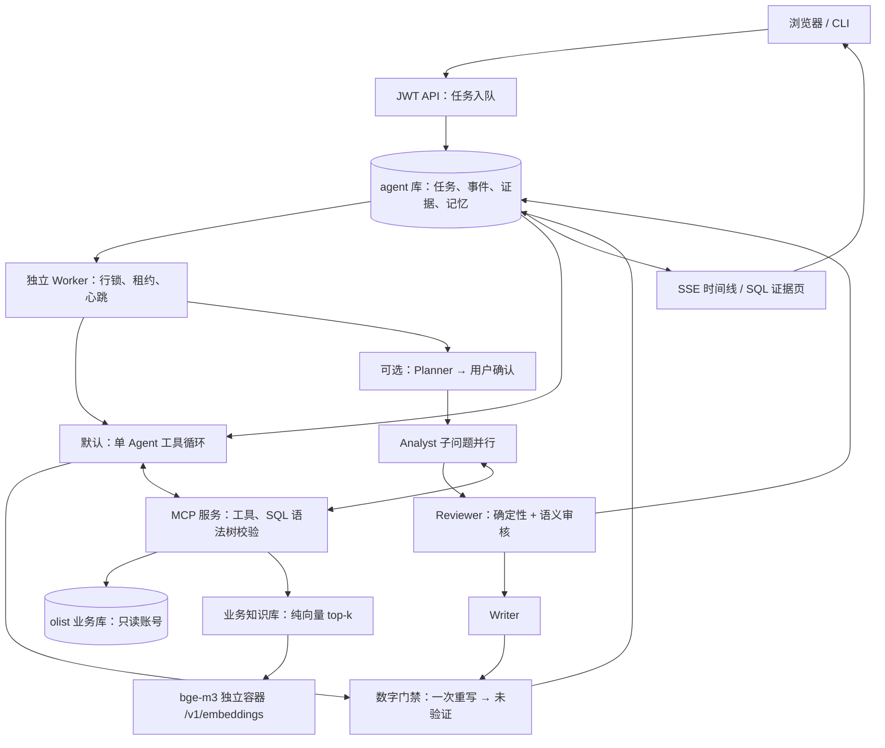
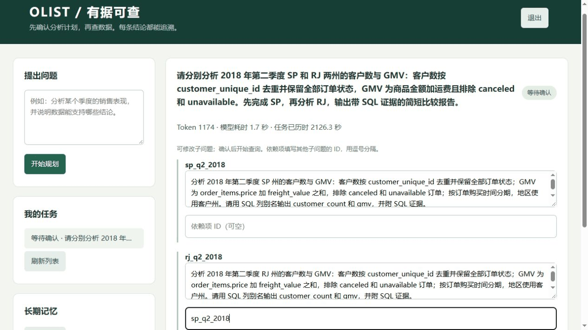

# Olist 经营分析 Agent

把中文经营问题转成只读 SQL 查询，用业务口径检索、用户偏好记忆和数字证据门禁生成可追溯的分析报告。

默认 **单 Agent + 数字门禁 + RAG inject + 纯向量 + Memory + 上下文 none**。长任务可选 mask；多智能体模式提供计划确认、语义审核、历史结论复用和子问题恢复。核心循环与编排均手写，不依赖 Agent 框架。

## 最终结果

下表是 Step 9 冻结的 holdout 成绩，对应 Step 11 边界修复前的代码；本次未重跑或重新计分 holdout。定向修复未达到采用门槛，默认分析提示及数字门禁已回退到 Step 9 行为，独立维度预检与后台任务控制仍保留；这不等于对当前部署重新测量 holdout。

最终表由真实运行收据生成，见 [最终评测与消融](docs/FINAL_RESULTS.md)。全部逐次原始指标保留在 [RESULTS](docs/RESULTS.md)，失误分析见 [FAILURES](docs/FAILURES.md)，项目描述见 [RESUME](docs/RESUME.md)。

| 题集 | 各轮正确 / 总题数 | 准确率均值 | 范围 |
| --- | --- | --- | --- |
| 全部 | 20/22；21/22；21/22 | 93.94% | 90.91%–95.45% |
| A | 3/3；3/3；3/3 | 100.00% | 100.00%–100.00% |
| B | 3/3；3/3；3/3 | 100.00% | 100.00%–100.00% |
| C | 8/8；8/8；8/8 | 100.00% | 100.00%–100.00% |
| D | 2/4；3/4；3/4 | 66.67% | 50.00%–75.00% |
| E | 4/4；4/4；4/4 | 100.00% | 100.00%–100.00% |

以上由 [真实统计收据](evidence/eval_step9-final-statistics-metadata-fix_20261017T105044Z_8d18a341.summary.json) 生成，汇总日志 `eval_step9-final-statistics-metadata-fix_20261017T105044Z_8d18a341.jsonl`。三个原始运行分别为：

- [`eval_step9-holdout-r1_20261017T104235Z_7648ab8d.jsonl`](evidence/eval_step9-holdout-r1_20261017T104235Z_7648ab8d.summary.json)
- [`eval_step9-holdout-r2_20261017T104451Z_7e1a9d1a.jsonl`](evidence/eval_step9-holdout-r2_20261017T104451Z_7e1a9d1a.summary.json)
- [`eval_step9-holdout-r3_20261017T104707Z_e9d273ef.jsonl`](evidence/eval_step9-holdout-r3_20261017T104707Z_e9d273ef.summary.json)

共 62/66 次作答正确，20/22 道题三轮均正确。D 关键事实命中率均值 69.23%，整体无证据结论比例均值 0.98%，D 无证据数字比例均值 0.71%；完整范围见最终表。平均 Agent 用量 9769.39 token，耗时 5959.68 ms，包含偏好设置/抽取，不含独立评分。

D11 三轮均因事实字段名不符合公开输出契约计为失败，虽然查询数值与标准值一致；D09 首轮跨查询行拼接结论对象。保留原判定，未重评或改提示。数值正确不等于结构与证据契约全部通过。

准确率是整题通过率；D 类关键事实命中率、无证据结论比例分别统计。holdout 只执行一次预声明协议，每题重复三次；没有用其结果调提示或代码。缺失 usage、未配置费用均留空。模型评分尚未人工校准，小题集结果不能代表生产表现。

## 架构



模型子进程仅接收聊天模型与 MCP 所需凭据，拿不到数据库密码和 JWT secret。单 Agent 的 Memory 保存明确用户偏好；只有可选 multi 的 Reviewer 通过结论才写 finding，旧数据版本的 finding 仅作为线索。

门禁约束报告正文中的数字来源，不能保证 SQL 口径正确，也不负责证明因果关系。差值、比率同样必须由 SQL 计算；Agent 不得自行运算。跨行结论按 SQL 原列名组织为行对象数组。

## 演示



可选多智能体模式的真实任务：修改计划依赖、确认执行、完成部分子问题后杀掉 worker、租约接管后复用检查点，最后点击金额查看 SQL。GIF 为阶段截图压缩成的演示，不用播放时长推算性能。首次重启命令失败和后续恢复均保留：[恢复证据](evidence/resume_demo_20261017T100621Z.summary.json)（日志 `resume_demo_20261017T100621Z.jsonl`）、[画面记录](evidence/ui_demo_20261017T100932Z_f92bcf6e.summary.json)（日志 `ui_demo_20261017T100932Z_f92bcf6e.jsonl`）。

## 快速启动

供应商限流默认关闭。由你按供应商文档在 `.env` 填写 `PROVIDER_RPM` / `PROVIDER_TPM`；可另设 `PROVIDER_MAX_INFLIGHT`。所有worker需保持一致配置，修改后同时重建worker。桶使用保守预扣，TPM容量必须能容纳单次预扣；等待超过 `RATE_WAIT_MAX_SECONDS` 返回 `rate_limited`。供应商熔断期间后台任务等待或重排，原任务截止时间继续生效。

已有环境升级本批代码：

```sh
docker compose build init-data
docker compose run --rm --no-deps --entrypoint python init-data -m scripts.migrate
docker compose up -d --no-deps api mcp-olist worker
```


Step 12.2 服务启动前会校验 `.env` 中数据库密码、MCP token、API 签名密钥与 worker 模型配置。API/MCP 的 `/healthz` 仅表示进程存活，API `/readyz` 探测 agent 库、MCP `/readyz` 同时探测 agent 与只读业务库；worker 的 olist 只读池按 findings 需求懒加载。修改代码后重建镜像并执行新增迁移，再重建 API/MCP/worker。worker 停止宽限为35秒，`WORKER_GRACE_SECONDS` 默认20秒并必须留足释放租约时间。连接池设置和来源见 [参数表](docs/PARAMETERS.md)。


需要 Docker Desktop 的 Linux 容器模式与 Compose。把 Olist 原始 CSV 放进 `data/raw/`，包含客户、地理位置、订单、订单商品、支付、评价、商品、卖家、品类翻译。原始数据不提交到 Git。

```powershell
Copy-Item .env.example .env
# 在 .env 填写 OPENAI_API_KEY、OPENAI_BASE_URL、OPENAI_MODEL。
# 或填写全部 DEEPSEEK_* 对应项；它们优先于 OPENAI_*。
$mcpToken = [guid]::NewGuid().ToString('N') + [guid]::NewGuid().ToString('N')
(Get-Content .env) -replace '^MCP_BEARER_TOKEN=.*', ('MCP_BEARER_TOKEN=' + $mcpToken) | Set-Content .env
$taskTokenSecret = [Convert]::ToBase64String([Security.Cryptography.RandomNumberGenerator]::GetBytes(48))
(Get-Content .env) -replace '^MCP_TOKEN_SECRET=.*', ('MCP_TOKEN_SECRET=' + $taskTokenSecret) | Set-Content .env
$memorySecret = [guid]::NewGuid().ToString('N') + [guid]::NewGuid().ToString('N')
(Get-Content .env) -replace '^MEMORY_API_SECRET=.*', ('MEMORY_API_SECRET=' + $memorySecret) | Set-Content .env
docker compose up -d --build
docker compose ps -a init-data
docker compose logs init-data
```

确认 `init-data` 正常退出后，打开 [本机工作台](http://localhost:8000)，注册并提问。默认直接分析；选择多智能体时需确认计划。[默认界面验收](evidence/step9_default_ui.summary.json)记录真实页面选择与控制台检查，日志 `step9_default_ui.json`。可选“压缩旧查询结果”使用 mask。已有 `.env` 升级时需对照下面的最终配置；环境中的显式旧值仍优先。

Step12.4新增任务签名密钥`MCP_TOKEN_SECRET`，与静态MCP令牌分开生成并保存在`.env`。新注册用户默认无业务数据权限；管理员在agent库为指定用户设置`data_scope=ARRAY['SP']`等州范围，或显式授予`ARRAY['ALL']`后才能分析。019迁移保留已有用户权限，本地CLI/评测新用户显式使用ALL。不要将静态CLI令牌提供给远程用户。

数据保留默认30天，通过`docker compose run --rm --no-deps --entrypoint python init-data -m scripts.maintenance retain`显式执行，保留最终答案与引用证据并审计；不会在启动时自动删除数据。登录用户可调用`DELETE /me`删除本人全部任务、偏好和findings。事件文本脱敏规则和保留例外见[工程化记录](docs/STEP12_HARDENING.md)。

```dotenv
AGENT_MODE=single
NUMBER_GATE=true
RAG_MODE=inject
RETRIEVAL_METHOD=vector
USE_MEMORY=true
CONTEXT_STRATEGY=none
CONTEXT_LIMIT=16000
TOKEN_BUDGET=100000
BOUNDARY_GUARDS=false
DIMENSION_PRECHECK=true
```

bge-m3 使用固定 revision `5617a9f61b028005a4858fdac845db406aefb181`，通过 `HF_ENDPOINT=https://hf-mirror.com` 下载，缓存于 Docker 数据卷；首次启动会等待下载与加载。每次评测保存模型名、revision，使用检索时还核对运行服务与权重哈希。聊天模型可替换；本次具体模型 ID 与供应商返回信息保存在运行收据里，不宣称云端权重已固定。

`init-data` 自动执行 `sql/migrations/` 中尚未运行的编号迁移，校验已执行文件哈希，随后导入 CSV 和构建索引。所有表结构变更新增迁移；不得修改已执行迁移。业务库和 Agent 库隔离，服务端口仅绑定本机。初次建库后修改 `.env` 不会自动更换现有数据库角色密码。

```powershell
# 命令行使用同一最终配置；相同 username 可读取已保存偏好。
docker compose run --rm --no-deps agent "2017 年 SP 州有多少客户？" --username demo
# 长任务开关；可选多智能体用 -e AGENT_MODE=multi。
docker compose run --rm --no-deps -e CONTEXT_STRATEGY=mask agent "分析季度销售变化" --username demo
# 恢复 worker 时不连带启动旧依赖镜像。
docker compose up -d --no-deps worker
```

单 Agent 中断后重跑当前任务；多智能体按已持久化子问题恢复。每个后台任务最多实际领取三次，第四次尝试直接标记失败并记录原因，防止崩溃任务无限重试。恢复任务可能缺失被中断请求的 usage，页面只显示已记录用量，完整总量留空。SSE 用 `Last-Event-ID` 续传，已完成任务重开也可查看历史事件。

## 评测与证据

题库按 dev/holdout 划分；C 题干使用自然业务问法，口径只在知识库中；每题有朴素 SQL 证明陷阱。标准答案另由 pandas 从原始 CSV 独立交叉验证，见 [交叉验证记录](eval/HUMAN_REVIEW.md)。评测器的 gold、标准值和私有评分 rubric 不传给模型进程；D 类会附上公开的所需事实字段名，但不提供对应值。

```powershell
# 可重复的 dev 实验；不会触发 holdout。
docker compose run --rm --no-deps init-data python -m eval.run --tag my-dev --categories C --split dev --adapter single --judge model --agent-mode single --number-gate true --rag-mode inject --use-memory true --context-strategy none --token-budget 100000
# 单元、真实数据库与 MCP 集成检查。
docker compose run --rm --no-deps -e RUN_DB_TESTS=1 -e RUN_MCP_TESTS=1 init-data python -m pytest -q
```

holdout 启动标记已经随证据提交，协议拒绝再次启动。只读汇总可以重新从收据生成，不调用模型；协议、源码快照、逐次日志名与每题结果见 [最终评测](docs/FINAL_RESULTS.md)。不要删除标记来重新挑选成绩。

关键证据在 `evidence/` 提交；完整日志留在本机 `logs/`，每份收据记录对应日志文件名及哈希。数据库密码、模型密钥、原始 CSV 不提交。测试 XML 为 [发布验证](evidence/step9_release_tests.xml)，日志 `step9_release_tests.log`。全新数据库与空缓存的 [隔离启动验收](evidence/fresh_compose_20261017T101027Z_450b90f6.summary.json)复用本机镜像与 CSV，不宣称在另一台物理机器验收。

Step 10 补充 [参数依据](docs/PARAMETERS.md)、[独立边界评测](docs/BOUNDARY_RESULTS.md)与[并发/故障验证](docs/ROBUSTNESS.md)。边界题逐项复核通过 6/10，仍存在未知维度当作零、时间范围未澄清和不完整年度误称完整的问题；它们不并入 holdout。两 worker 六任务无重复领取，正式采样连接峰值为 5，全部任务耗时 14.824 秒；来源与采样局限见工程报告。新增毒任务上限，未为边界题调整 Agent 提示，也未重跑 holdout。

对应证据：[边界真实运行](evidence/eval_step10-boundary_20261017T110935Z_62bc557e.summary.json)、[逐项复核](evidence/step10_boundary_review.summary.json)、[正式并发](evidence/step10_concurrency_20261017T111217Z_702ad536.summary.json)。原始日志分别为 `eval_step10-boundary_20261017T110935Z_62bc557e.jsonl` 与 `step10_concurrency_20261017T111217Z_702ad536.jsonl`；复核日志名保存在复核收据中。

设计依据与局限见 [最终决策](docs/DECISIONS.md)；早期实验、失败与修复完整保留在 [决策历史](docs/DECISIONS_HISTORY.md)、[重复对比](docs/REVIEW_COMPARISON.md)和 [finding 复用](docs/FINDING_REUSE.md)。本次仅执行 Step 11，完成后停止等待审查。


## Step 11：边界与任务控制

维度预检在代码层默认开启，未知值先请求核对，有效查询不增加提示或返回字段。边界增强现为可选开关 `BOUNDARY_GUARDS=true`：只保留一句澄清规则，代码判断日期越界时才补一行覆盖说明，并启用日期/工具常量识别。默认关闭这一增强，恢复 Step 9 的分析提示和门禁行为。唯一一次定向修复的采用条件、完整结果与回退边界见 [定向验收](docs/STEP11_TARGETED.md)。

此前 Step 11“无退化”验收未通过：C 17/17、E 6/6，但 D 为 3/8，低于同核查器旧基线的 7/8。原、新边界题按保存回答复核均为 9/10；它们是格式/契约补丁前各一次真实运行，补丁后仅做离线格式回放。历史来源及额外 dev 运行已在 [对照证据](evidence/step11_verification_20261017T115123Z_ee268211.summary.json) 保留，汇总日志 `step11_verification_20261017T115123Z_ee268211.jsonl`。

可选边界增强：在 `.env` 设置 `BOUNDARY_GUARDS=true` 后重新创建 `api`、`worker`；CLI 可用 `docker compose run --rm --no-deps -e BOUNDARY_GUARDS=true agent "问题" --username demo`。`DIMENSION_PRECHECK` 属于 MCP 服务，默认开启且不依赖该增强开关。

后台任务新增 `POST /tasks/{id}/cancel` 和 `GET /quota`。默认总时长 300 秒（含排队/确认）、每用户并发 2、UTC 日 token 额度 1000000，均可在 .env 中配置。预留额度与已确认用量分开；中断后未知用量不当作零。配置、限制与真实测试证据见 [任务控制](docs/TASK_CONTROLS.md)。GitHub Actions 在 push/pull_request 时运行离线单元测试，模型评测不自动触发。


### Step 12.3 追踪与指标

先重建镜像并执行新增迁移，再启动API/MCP/worker。可选的Jaeger：

```bash
docker compose --profile observability up -d jaeger
```

在`.env`填写`OTEL_EXPORTER_OTLP_ENDPOINT=http://jaeger:4318`后重建相关服务；留空不导出。Jaeger界面为 http://localhost:16686 ，本地演示使用内存存储，容器重启后数据不保留。API的`/metrics`提供Prometheus文本，采集端请使用内部网络。三种token单价在`.env`按供应商价格填写，空值保持费用未知。指标、语义约定版本和告警阈值见[参数表](docs/PARAMETERS.md)与[工程化收据](docs/STEP12_HARDENING.md)。历史成绩仍属于Step9源码。

本地故障演练使用可选的Toxiproxy，模型全部为HTTP替身：

```bash
docker compose --profile chaos up -d toxiproxy
# 在独立验收数据库运行，先停常驻worker，避免领取替身任务。
docker compose stop worker
docker compose run --rm --no-deps init-data python -m scripts.step12_chaos network_baseline
docker compose run --rm --no-deps init-data python -m scripts.step12_chaos latency
docker compose run --rm --no-deps init-data python -m scripts.step12_chaos packet_loss
docker compose run --rm --no-deps init-data python -m scripts.step12_chaos load
```

容器产物需要挂载工作区或复制出来归档；脚本使用当前镜像源码，修改后先重建。数据库重启场景由`db_restart`模式写出`logs/step12_chaos_db_restart_ready.json`后等待操作者写入信号时间并重启数据库；本次实测命令及时间已保存在收据。演练结束后确认任务已终止，再恢复原worker。已有SIGTERM/503收据在12.3中直接复用，不重跑。

第2批已取得完整[真实任务trace](evidence/step12_b3_real_trace.json)、[Jaeger截图](evidence/step12_b3_jaeger.png)、[/metrics样例](evidence/step12_b3_metrics.prom)和[100任务压测](evidence/step12_chaos_load.json)。压测100/100成功、100个同时SSE、连接峰值24/池上限36；丢失故障仅1/5成功，局限与未修改项完整记录在工程报告，不作为真实模型性能或质量数据。


### Step 12.4–12.5 安全、数据与回归状态

已增加短期任务JWT、州范围RLS、事件脱敏及审计保留、数据/黑板版本。`CONTEXT_PREFLIGHT`默认关闭；备用三项配置全空时不切换。本地没有配置备用，只有切换逻辑和替身测试。新迁移执行和权限分配后再恢复服务，参数与局限见[工程报告](docs/STEP12_HARDENING.md)。最终镜像内379项全量测试通过，离线CI287项通过。

唯一一次默认C/D/E dev回归在第19题因事件序号冲突中断：已尝试19题工程失败，12题未运行，**未达到验收标准**。问题已另行测试并修复，未续跑、未重跑；不能据此宣称效果无退化。实际消耗103659 tokens，缓存命中率44.90%，价格未配置故费用留空。[逐题结果](docs/RESULTS.md#step-12-默认配置回归唯一一次中途中断未达标)与[一次性协议](evidence/step12_regression_protocol.json)保留原始结果。README历史成绩仍属于Step9源码，holdout未重跑或重新评分。


第3批复核已完成RLS优化和真实评测全流程替身演练：31题无工程错误，替身结果不算成绩。v1经审查作废，原记录保留；v2协议已独立提交203dd7f。当前因.env三项token价格未填而停止在v2启动前，未调用真实模型。RLS单次重测p50/p95为29.114/73.780ms，详见[执行计划诊断](evidence/step12_c2_explain.md)。全量391项、离线CI297项通过。
