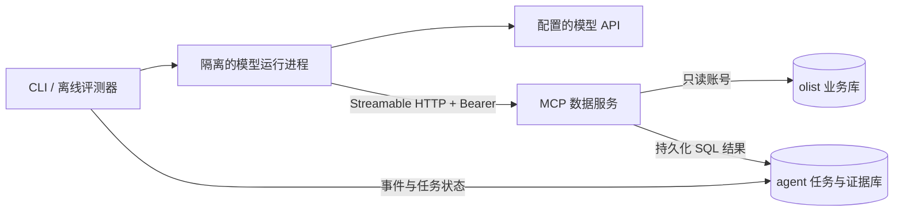

# Olist 经营分析 Agent

面向中文经营分析的手写 Agent，通过独立 MCP 服务查询 Olist 数据并引用持久化 SQL 结果。当前已实现 Step 0–2：环境与迁移、独立评测、单 Agent 循环和 MCP 数据服务；多智能体审核尚待后续步骤。完整计划见 [docs/Plan.md](docs/Plan.md)。

## Step 0：启动

需要 Docker Desktop（Linux 容器）与 Docker Compose。容器内脚本使用 Python 3.11，数据库使用 PostgreSQL 16 + pgvector。宿主机无需安装 Python。

将 Kaggle Olist 数据集的全部原始 CSV 放入 `data/raw/`，包括客户、地理位置、订单、订单商品、支付、评价、商品、卖家和品类翻译表。原始数据、密码和完整运行日志不提交到 Git；关键的小型证据保存在 evidence/ 并提交。

```powershell
Copy-Item .env.example .env
# 首次启动前按需修改 .env 中的本地数据库密码和端口。
$mcpToken = [guid]::NewGuid().ToString('N') + [guid]::NewGuid().ToString('N')
(Get-Content .env) -replace '^MCP_BEARER_TOKEN=.*', ('MCP_BEARER_TOKEN=' + $mcpToken) | Set-Content .env
docker compose up -d --build
docker compose wait init-data
docker compose logs init-data
```

`db` 健康后 `init-data` 自动执行尚未执行的编号迁移，再导入全部 CSV，随后生成 `docs/data_profile.md`。`up -d` 返回只表示容器已启动；应等待 `init-data` 正常退出后再使用业务数据。缺少文件或导入失败会返回非零退出码，错误在容器日志与 `logs/load_olist_*.jsonl` 中。

默认地址为 `localhost:5432`，库名为 `olist`、`agent`。`agent_ro` 仅有业务库 SELECT 权限，默认查询超时为 10 秒；`agent_app` 用于 Agent 库写入。密码见 `.env`，未配置时 Compose 使用 `.env.example` 中的本地开发默认值。端口只绑定回环地址。

初始化脚本仅在首次创建数据卷时运行；修改 `.env` 不会自动修改现有角色密码。业务数据重新导入也不会清空 Agent 库。

每次 `init-data` 启动都会先运行 [编号迁移](sql/migrations/README.md)。`agent.schema_migrations` 记录执行时间与文件哈希；已执行迁移不可编辑，所有后续表结构变更新增迁移文件。现有 Step 0 数据可以直接升级，无需删除数据卷。

## 重跑与画像

```powershell
# 相同输入跳过重复导入，并重新生成画像。
docker compose run --rm init-data
# 单独重新生成画像。
docker compose run --rm init-data python scripts/profile_data.py
```

输入文件变化时脚本会拒绝覆盖已有数据。确实需要替换业务数据时，显式运行：

```powershell
docker compose run --rm init-data python scripts/load_olist.py --replace --profile
```

该命令在事务内替换业务表，更新数据版本；旧证据保留原始版本。不可通过删除 Docker 数据卷进行日常重导，否则 Agent 数据也会丢失。

如需在宿主机运行（Python 3.11 或更高）：

```powershell
python -m pip install -e '.[dev]'
python scripts/load_olist.py --profile
python scripts/profile_data.py
```

## 验收

```powershell
docker compose run --rm -e RUN_DB_TESTS=1 init-data python -m pytest -q
```

验收连接真实数据库，检查两个库、pgvector、核心表、CSV 与入库行数一致、只读权限、跨库隔离、事件只追加和完整证据存储。Step 0 权限测试的写入回滚；Step 2 跨进程 MCP 集成测试保留独立测试任务和查询证据。未设置 `RUN_DB_TESTS=1` 时跳过数据库验收，`RUN_MCP_TESTS=1` 才启用真实 MCP 验收；跳过不代表通过。

本机实际验收已完成：

- 迁移升级验收：`22 passed`，包含全新数据库、重复启动、失败回滚和跨库提交间隙恢复；见 [升级验收 XML](evidence/step0_migrations_20261017T062040Z.xml)。

- `db` 健康，`init-data` 退出码为 `0`，全部原始 CSV 已导入，两个库均可连接。
- `19 passed`，含真实数据库权限和事件不可变性检查。逐用例结果：[JUnit XML](evidence/step0_pytest_20261017T061031Z.xml)。
- 首次导入日志：[load_olist_20261017T061005Z_cb15c045.jsonl](evidence/load_olist_20261017T061005Z_cb15c045.summary.json)。
- 重复执行返回 `already_loaded`，行数与数据版本保持一致。日志：[load_olist_20261017T061052Z_251dff07.jsonl](evidence/load_olist_20261017T061052Z_251dff07.summary.json)。
- 数据画像已生成，来源日志：[profile_data_20261017T061022Z_8f7105c7.jsonl](evidence/profile_data_20261017T061022Z_8f7105c7.summary.json)。关键证据随 Git 保存；完整运行日志仍保存在本机 logs/。

## 可追溯记录

- [数据画像](docs/data_profile.md)：业务数据统计，包含来源 SQL、数据版本和画像日志文件名。
- [设计决策](docs/DECISIONS.md)：问题、候选方案、选择原因和验证依据。
- [评测结果](docs/RESULTS.md)：仅由 `eval/run.py` 的真实运行追加，未运行指标留空。环境测试和数据画像不计为 Agent 评测成绩。

## Step 1：题库与独立评测

已生成 67 道题（A/B/C/D/E 为 10/10/25/12/10），固定划分 dev 45 题、holdout 22 题。C 的陷阱来自实际数据画像，两个划分的题干均使用不泄露口径的业务自然问法；每个模板有私有 naive SQL，与 gold SQL 实跑比较，剔除或替换标准答案为零、差异不足 1% 的题目。E 的用户偏好跨两个任务测试。gold／naive SQL 与评分规则不传给被测适配器，C 类口径留到 Step 4 知识库提供。详见 [评测协议](eval/README.md) 和 [标准答案交叉验证记录](eval/HUMAN_REVIEW.md)。

```powershell
docker compose build init-data
docker compose run --rm init-data python eval/validate_gold.py
docker compose run --rm init-data python eval/run.py --tag zero-smoke --categories C,D --split dev
$stamp = [DateTime]::UtcNow.ToString('yyyyMMddTHHmmssZ')
docker compose run --rm -e RUN_DB_TESTS=1 init-data python -m pytest -q --junitxml="evidence/step1_review_$stamp.xml"
```

实际验收：

- 全部标准 SQL 可执行并符合答案形状：67 / 67；C 类 25 / 25 的标准答案非零，与朴素答案的差异达到 1%，见 [SQL 与陷阱验证摘要](evidence/validate_gold_20261017T064243Z_88d30427.summary.json)。原始日志：`validate_gold_20261017T064243Z_88d30427.jsonl`。
- 最终镜像内 `66 passed`，覆盖真实数据库、零值／弱陷阱拒绝、验证失败后继续检查、报告下降／减少／负环比、错误幅度和未经 SQL 计算的差值拒绝等，见 [pytest XML](evidence/step1_revision_pytest_20261017T064436Z.xml)。原始日志：`step1_revision_pytest_20261017T064436Z.log`。
- 固定回答零的夹具已在修订后的 C、D dev 题实跑：0 / 25 正确。该结果仅证明评分链路工作，不是 Agent 能力基线。见 [真实运行汇总](evidence/eval_zero-smoke-revision_20261017T064502Z_4a4ae9ce.summary.json)，原始日志：`eval_zero-smoke-revision_20261017T064502Z_4a4ae9ce.jsonl`。RESULTS 保留旧题库的历史实跑记录，题库哈希不同，不应视作模型效果的前后对比。
- 模型归因评分及人工评分校准尚未完成；未运行的评分留空，不能视作已校准。标准答案的人工核对已按用户要求改为下面的自动交叉验证。

`evidence/` 中保留每次运行的独立摘要和 XML；新测试应使用新的文件名，避免覆盖已提交证据。`--judge model` 控制额外的归因评分调用；`--adapter single` 即使 judge 关闭也会调用模型。费用只能根据响应 usage 和显式配置的单价计算。

报告中的所有业务数字（包括差值、比率）必须由 SQL 计算并保存为可引用结果，Agent 不得自行计算。报告数字按绝对值匹配已验证的证据，结构化 claim.value 仍保留 SQL 的符号和精度；数值核查不能证明文字方向或因果解释正确。

## 原始 CSV 自动交叉验证

`eval/cross_check.py` 用 pandas 直接读取全部原始 CSV，独立实现各题的分组、去重、时间筛选和比率计算。计算器只接收题号、模板标识与参数，不执行 SQL、不访问数据库、不导入 gold 模板或评分实现；SQL 标准答案只从已保存的验证收据中读取，用于最终比较。金额采用浮点重算，数值误差不超过 1% 视为一致，零值只允许表示误差；列表比较集合，D 类事实逐字段比较。

```powershell
docker compose run --rm init-data python eval/validate_gold.py
$gold = (Get-ChildItem evidence/validate_gold_*.summary.json | Sort-Object LastWriteTime -Descending | Select-Object -First 1).Name
# 覆盖 entrypoint，避免交叉验证进程执行迁移或任何数据库查询。
docker compose run --rm --entrypoint python -v "${PWD}/eval:/app/eval" init-data eval/cross_check.py --gold-evidence "evidence/$gold"
```

实际结果：67 / 67 一致，不一致题目为空，gold 未改动。见 [逐题交叉验证证据](evidence/cross_check_20261017T070428Z_accb136c.summary.json)，原始日志 `cross_check_20261017T070428Z_accb136c.jsonl`。证据记录每题两种答案、差异、原始 CSV 哈希、题库哈希、计算器版本和对应 SQL 收据；[HUMAN_REVIEW.md](eval/HUMAN_REVIEW.md) 自动更新 C、E、D 类结果。不一致时返回非零退出码并列出题号，不自动修 gold。

## Step 2：单 Agent 与 MCP

在 `.env` 填写 `OPENAI_API_KEY`、`OPENAI_BASE_URL`、`OPENAI_MODEL`，也支持完整的 `DEEPSEEK_API_KEY`、`DEEPSEEK_BASE_URL`、`DEEPSEEK_MODEL` 组合（显式 DeepSeek 配置优先）。不要提交密钥。MCP token 是同一部署内部的服务凭据，首次生成后由客户端和服务共同使用；用户登录与授权留到 Step 8。

```powershell
docker compose up -d --build
docker compose run --rm agent '订单表共有多少订单？'
docker compose run --rm init-data python eval/run.py --adapter single --schema-mode full --tag baseline-full --categories A,B --split dev --judge off
docker compose run --rm init-data python eval/run.py --adapter single --schema-mode on_demand --tag baseline-on-demand --categories A,B --split dev --judge off
$stamp = [DateTime]::UtcNow.ToString('yyyyMMddTHHmmssZ')
docker compose run --rm -e RUN_DB_TESTS=1 -e RUN_MCP_TESTS=1 init-data python -m pytest -q --junitxml="evidence/step2_$stamp.xml"
```



模型运行进程只保留模型与 MCP 配置，不继承数据库环境变量，不加载 `.env`，也没有数据库工具。MCP 工具由 `list_tools` 动态发现；本地 `final_answer` 进入同一注册表。每轮工具并行执行，错误作为观察结果交回模型；接口失败退避重试，四类终止条件及全部调用记录到事件表。工具数据以转义后的独立标记包裹，提示词明确其不具备指令效力；这不是提示注入无法发生的保证。

SQL 经 AST 白名单校验，只允许业务表只读查询，再由只读数据库账号和查询超时兜底。未指定或超过上限的 LIMIT 均限制到 1000；`row_count`、数值统计与持久化完整结果均对应**实际执行的限行查询**，预览只传前 20 行。全量总数和报告中的差值、比率应在 SQL 中聚合计算。新列注释通过 `003_olist_column_comments.sql` 迁移添加，既有迁移不修改。

本次模型为 `deepseek-flash`，Agent 请求固定 temperature=0，并显式关闭该服务的 thinking 模式；原始响应的模型名、fingerprint 和 usage 保存在每次评测证据中。A、B 类 dev 实跑结果如下，D／C／E 和 holdout 模型评测尚未运行：

| 结构模式 | 答案正确 | 平均 token / 题 | 平均模型步数 | 无证据结论 | 真实运行证据 |
| --- | --- | --- | --- | --- | --- |
| full | 14 / 14 | 5576.21 | 2.0 | 2 / 14 | [full 汇总](evidence/eval_baseline-full_20261017T070736Z_def8c3a7.summary.json) |
| on_demand | 14 / 14 | 4434.14 | 2.5 | 2 / 14 | [on_demand 汇总](evidence/eval_baseline-on-demand_20261017T070828Z_4dd93f3c.summary.json) |

对应原始日志为 `eval_baseline-full_20261017T070736Z_def8c3a7.jsonl`、`eval_baseline-on-demand_20261017T070828Z_4dd93f3c.jsonl`。[RESULTS](docs/RESULTS.md) 的两行由评测脚本真实追加；单价未配置，费用留空。暂用 on_demand；本次准确率相同且 token 更低，但多调用了结构工具，不能据此推断复杂题或 holdout 效果。

两组的 A05 都自行数出状态数量，SQL 未返回该计数；B06 将多行州金额拼成以州名为键的对象，未遵循 SQL 列名与单行对应规则。独立核查器均拒绝这些 claim。A/B 的答案正确率与证据支持率分别计算，满分答案不代表证据合格；没有调整核查器或删去这些结果。

验收证据：

- [完整测试 XML](evidence/step2_pytest_20261017T070651Z.xml)：134 passed，原始日志 `step2_pytest_20261017T070651Z.log`，包含真实 PostgreSQL、MCP、攻击拦截、循环和 CSV 计算器测试。
- [真实 CLI 调用](evidence/ask_20261017T065752Z_b426c568.summary.json)：实际模型返回可查询的证据 ID。
- [官方 Inspector CLI 验证](evidence/inspector_20261017T070435Z_e3c0a23e.summary.json)与[界面调用证据](evidence/inspector_ui_20261017T071031Z_4d025329.summary.json)：独立客户端成功调用标准 MCP `run_sql`。使用安全维护中的 Inspector v1.0.2；界面默认工具风险标签不代表数据库权限，服务仍强制只读 SQL。
- [Inspector 成功状态与 SQL 截图](evidence/step2_inspector_20261017T070945Z.jpg)、[实际订单数截图](evidence/step2_inspector_20261017T070930Z.jpg)，鉴权设置折叠，截图不含 token。

Inspector 的 CLI 重现：先运行 `docker compose run --rm init-data python -m scripts.inspector_demo prepare` 生成本地任务及 `logs/inspector.private.json`，用官方客户端向 `http://localhost:8001/mcp` 发送该文件中的 Authorization 和 X-Task-ID 请求头。完整命令见 [评测协议](eval/README.md)。私有配置只留在忽略的 logs 目录。

Step 2 完成后停下，等待用户确认再进入 Step 3；Step 6 结束仍需再次确认。
