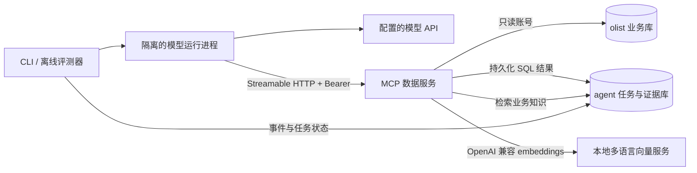
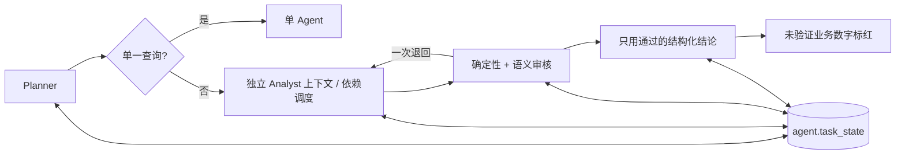

# Olist 经营分析 Agent

面向中文经营分析的手写 Agent，通过独立 MCP 服务查询 Olist 数据，生成可追溯到 SQL 的报告。包含数字门禁、可选多智能体审核、已审核结论记忆，以及登录、计划确认、实时进度和租约恢复的网页工作台。当前执行范围截至 Step 8；Step 9 的 holdout 最终评测尚未开始。完整计划见 [docs/Plan.md](docs/Plan.md)。

## Step 0：启动

需要 Docker Desktop（Linux 容器）与 Docker Compose。容器内脚本使用 Python 3.11，数据库使用 PostgreSQL 16 + pgvector。宿主机无需安装 Python。

将 Kaggle Olist 数据集的全部原始 CSV 放入 `data/raw/`，包括客户、地理位置、订单、订单商品、支付、评价、商品、卖家和品类翻译表。原始数据、密码和完整运行日志不提交到 Git；关键的小型证据保存在 evidence/ 并提交。

```powershell
Copy-Item .env.example .env
# 首次启动前填写 .env 中的聊天模型配置，并按需修改数据库密码和端口。
$mcpToken = [guid]::NewGuid().ToString('N') + [guid]::NewGuid().ToString('N')
(Get-Content .env) -replace '^MCP_BEARER_TOKEN=.*', ('MCP_BEARER_TOKEN=' + $mcpToken) | Set-Content .env
$memorySecret = [guid]::NewGuid().ToString('N') + [guid]::NewGuid().ToString('N')
(Get-Content .env) -replace '^MEMORY_API_SECRET=.*', ('MEMORY_API_SECRET=' + $memorySecret) | Set-Content .env
docker compose up -d --build
docker compose ps -a init-data
docker compose logs init-data
```

`db` 和向量服务健康后 `init-data` 自动执行尚未执行的编号迁移，导入全部 CSV，生成 `docs/data_profile.md` 并重建知识索引。API 与独立 worker 随后自动启动。首次模型下载可能需要等待，缓存保存在 Docker 数据卷。完成后打开 [本机工作台](http://localhost:8000)，注册、提问并确认计划。`up -d` 返回只表示容器已启动；应等待 `init-data` 正常退出后再使用业务数据。缺少文件或导入失败会返回非零退出码，错误在容器日志与 `logs/load_olist_*.jsonl` 中。

默认地址为 `localhost:5432`，库名为 `olist`、`agent`。`agent_ro` 仅有业务库 SELECT 权限，默认查询超时为 10 秒；`agent_app` 用于 Agent 库写入。密码见 `.env`，未配置时 Compose 使用 `.env.example` 中的本地开发默认值。端口只绑定回环地址。

初始化脚本仅在首次创建数据卷时运行；修改 `.env` 不会自动修改现有角色密码。业务数据重新导入也不会清空 Agent 库。

每次 `init-data` 启动都会先运行 [编号迁移](sql/migrations/README.md)。`agent.schema_migrations` 记录执行时间与文件哈希；已执行迁移不可编辑，所有后续表结构变更新增迁移文件。现有 Step 0 数据可以直接升级，无需删除数据卷。

## 重跑与画像

```powershell
# 相同输入跳过重复导入，并重新生成画像。
docker compose run --rm --no-deps init-data
# 单独重新生成画像。
docker compose run --rm --no-deps init-data python scripts/profile_data.py
```

输入文件变化时脚本会拒绝覆盖已有数据。确实需要替换业务数据时，显式运行：

```powershell
docker compose run --rm --no-deps init-data python scripts/load_olist.py --replace --profile
```

该命令在事务内替换业务表，更新数据版本；旧证据保留原始版本。不可通过删除 Docker 数据卷进行日常重导，否则 Agent 数据也会丢失。

如需在宿主机运行（Python 3.11 或更高）：

```powershell
python -m pip install -e '.[dev]'
python scripts/load_olist.py --profile
python scripts/profile_data.py
```

## 验收

```powershell
docker compose run --rm --no-deps -e RUN_DB_TESTS=1 init-data python -m pytest -q
```

验收连接真实数据库，检查两个库、pgvector、核心表、CSV 与入库行数一致、只读权限、跨库隔离、事件只追加和完整证据存储。Step 0 权限测试的写入回滚；Step 2 跨进程 MCP 集成测试保留独立测试任务和查询证据。未设置 `RUN_DB_TESTS=1` 时跳过数据库验收，`RUN_MCP_TESTS=1` 才启用真实 MCP 验收；跳过不代表通过。

本机实际验收已完成：

- 迁移升级验收：`22 passed`，包含全新数据库、重复启动、失败回滚和跨库提交间隙恢复；见 [升级验收 XML](evidence/step0_migrations_20261017T062040Z.xml)。

- `db` 健康，`init-data` 退出码为 `0`，全部原始 CSV 已导入，两个库均可连接。
- `19 passed`，含真实数据库权限和事件不可变性检查。逐用例结果：[JUnit XML](evidence/step0_pytest_20261017T061031Z.xml)。
- 首次导入日志：[load_olist_20261017T061005Z_cb15c045.jsonl](evidence/load_olist_20261017T061005Z_cb15c045.summary.json)。
- 重复执行返回 `already_loaded`，行数与数据版本保持一致。日志：[load_olist_20261017T061052Z_251dff07.jsonl](evidence/load_olist_20261017T061052Z_251dff07.summary.json)。
- 数据画像已生成，来源日志：[profile_data_20261017T061022Z_8f7105c7.jsonl](evidence/profile_data_20261017T061022Z_8f7105c7.summary.json)。关键证据随 Git 保存；完整运行日志仍保存在本机 logs/。

## 可追溯记录

- [数据画像](docs/data_profile.md)：业务数据统计，包含来源 SQL、数据版本和画像日志文件名。
- [设计决策](docs/DECISIONS.md)：问题、候选方案、选择原因和验证依据。
- [评测结果](docs/RESULTS.md)：仅由 `eval/run.py` 的真实运行追加，未运行指标留空。环境测试和数据画像不计为 Agent 评测成绩。

## Step 1：题库与独立评测

已生成 67 道题（A/B/C/D/E 为 10/10/25/12/10），固定划分 dev 45 题、holdout 22 题。C 的陷阱来自实际数据画像，两个划分的题干均使用不泄露口径的业务自然问法；每个模板有私有 naive SQL，与 gold SQL 实跑比较，剔除或替换标准答案为零、差异不足 1% 的题目。E 的用户偏好跨两个任务测试。gold／naive SQL 与评分规则不传给被测适配器，C 类口径留到 Step 4 知识库提供。详见 [评测协议](eval/README.md) 和 [标准答案交叉验证记录](eval/HUMAN_REVIEW.md)。

```powershell
docker compose build init-data
docker compose run --rm --no-deps init-data python eval/validate_gold.py
docker compose run --rm --no-deps init-data python eval/run.py --tag zero-smoke --categories C,D --split dev
$stamp = [DateTime]::UtcNow.ToString('yyyyMMddTHHmmssZ')
docker compose run --rm --no-deps -e RUN_DB_TESTS=1 init-data python -m pytest -q --junitxml="evidence/step1_review_$stamp.xml"
```

实际验收：

- 全部标准 SQL 可执行并符合答案形状：67 / 67；C 类 25 / 25 的标准答案非零，与朴素答案的差异达到 1%，见 [SQL 与陷阱验证摘要](evidence/validate_gold_20261017T064243Z_88d30427.summary.json)。原始日志：`validate_gold_20261017T064243Z_88d30427.jsonl`。
- 最终镜像内 `66 passed`，覆盖真实数据库、零值／弱陷阱拒绝、验证失败后继续检查、报告下降／减少／负环比、错误幅度和未经 SQL 计算的差值拒绝等，见 [pytest XML](evidence/step1_revision_pytest_20261017T064436Z.xml)。原始日志：`step1_revision_pytest_20261017T064436Z.log`。
- 固定回答零的夹具已在修订后的 C、D dev 题实跑：0 / 25 正确。该结果仅证明评分链路工作，不是 Agent 能力基线。见 [真实运行汇总](evidence/eval_zero-smoke-revision_20261017T064502Z_4a4ae9ce.summary.json)，原始日志：`eval_zero-smoke-revision_20261017T064502Z_4a4ae9ce.jsonl`。RESULTS 保留旧题库的历史实跑记录，题库哈希不同，不应视作模型效果的前后对比。
- 模型归因评分及人工评分校准尚未完成；未运行的评分留空，不能视作已校准。标准答案的人工核对已按用户要求改为下面的自动交叉验证。

`evidence/` 中保留每次运行的独立摘要和 XML；新测试应使用新的文件名，避免覆盖已提交证据。`--judge model` 控制额外的归因评分调用；`--adapter single` 即使 judge 关闭也会调用模型。费用只能根据响应 usage 和显式配置的单价计算。

报告中的所有业务数字（包括差值、比率）必须由 SQL 计算并保存为可引用结果，Agent 不得自行计算。报告数字按绝对值匹配已验证的证据，结构化 claim.value 仍保留 SQL 的符号和精度；数值核查不能证明文字方向或因果解释正确。

## 原始 CSV 自动交叉验证

`eval/cross_check.py` 用 pandas 直接读取全部原始 CSV，独立实现各题的分组、去重、时间筛选和比率计算。计算器只接收题号、模板标识与参数，不执行 SQL、不访问数据库、不导入 gold 模板或评分实现；SQL 标准答案只从已保存的验证收据中读取，用于最终比较。金额采用浮点重算，数值误差不超过 1% 视为一致，零值只允许表示误差；列表比较集合，D 类事实逐字段比较。

```powershell
docker compose run --rm --no-deps init-data python eval/validate_gold.py
$gold = (Get-ChildItem evidence/validate_gold_*.summary.json | Sort-Object LastWriteTime -Descending | Select-Object -First 1).Name
# 覆盖 entrypoint，避免交叉验证进程执行迁移或任何数据库查询。
docker compose run --rm --no-deps --entrypoint python -v "${PWD}/eval:/app/eval" init-data eval/cross_check.py --gold-evidence "evidence/$gold"
```

实际结果：67 / 67 一致，不一致题目为空，gold 未改动。见 [逐题交叉验证证据](evidence/cross_check_20261017T070428Z_accb136c.summary.json)，原始日志 `cross_check_20261017T070428Z_accb136c.jsonl`。证据记录每题两种答案、差异、原始 CSV 哈希、题库哈希、计算器版本和对应 SQL 收据；[HUMAN_REVIEW.md](eval/HUMAN_REVIEW.md) 自动更新 C、E、D 类结果。不一致时返回非零退出码并列出题号，不自动修 gold。

## Step 2：单 Agent 与 MCP

在 `.env` 填写 `OPENAI_API_KEY`、`OPENAI_BASE_URL`、`OPENAI_MODEL`，也支持完整的 `DEEPSEEK_API_KEY`、`DEEPSEEK_BASE_URL`、`DEEPSEEK_MODEL` 组合（显式 DeepSeek 配置优先）。不要提交密钥。MCP token 是同一部署内部的服务凭据，首次生成后由客户端和服务共同使用；网页接口使用独立 JWT 登录，任务、证据和记忆按 JWT 用户隔离；MCP 服务凭据不交给浏览器。

```powershell
docker compose up -d --build
docker compose run --rm --no-deps agent '订单表共有多少订单？'
docker compose run --rm --no-deps init-data python eval/run.py --adapter single --schema-mode full --tag baseline-full --categories A,B --split dev --judge off
docker compose run --rm --no-deps init-data python eval/run.py --adapter single --schema-mode on_demand --tag baseline-on-demand --categories A,B --split dev --judge off
$stamp = [DateTime]::UtcNow.ToString('yyyyMMddTHHmmssZ')
docker compose run --rm --no-deps -e RUN_DB_TESTS=1 -e RUN_MCP_TESTS=1 init-data python -m pytest -q --junitxml="evidence/step2_$stamp.xml"
```



模型运行进程只保留模型与 MCP 配置，不继承数据库环境变量，不加载 `.env`，也没有数据库工具。MCP 工具由 `list_tools` 动态发现；本地 `final_answer` 进入同一注册表。每轮工具并行执行，错误作为观察结果交回模型；接口失败退避重试，四类终止条件及全部调用记录到事件表。工具数据以转义后的独立标记包裹，提示词明确其不具备指令效力；这不是提示注入无法发生的保证。

SQL 经 AST 白名单校验，只允许业务表只读查询，再由只读数据库账号和查询超时兜底。未指定或超过上限的 LIMIT 均限制到 1000；`row_count`、数值统计与持久化完整结果均对应**实际执行的限行查询**，预览只传前 20 行。全量总数和报告中的差值、比率应在 SQL 中聚合计算。新列注释通过 `003_olist_column_comments.sql` 迁移添加，既有迁移不修改。

本次模型为 `deepseek-flash`，Agent 请求固定 temperature=0，并显式关闭该服务的 thinking 模式；原始响应的模型名、fingerprint 和 usage 保存在每次评测证据中。下面保留 Step 2 当时的 A、B dev 基线；后续 C/D/E 实验见 RESULTS，holdout 模型评测仍未运行：

| 结构模式 | 答案正确 | 平均 token / 题 | 平均模型步数 | 无证据结论 | 真实运行证据 |
| --- | --- | --- | --- | --- | --- |
| full | 14 / 14 | 5576.21 | 2.0 | 2 / 14 | [full 汇总](evidence/eval_baseline-full_20261017T070736Z_def8c3a7.summary.json) |
| on_demand | 14 / 14 | 4434.14 | 2.5 | 2 / 14 | [on_demand 汇总](evidence/eval_baseline-on-demand_20261017T070828Z_4dd93f3c.summary.json) |

对应原始日志为 `eval_baseline-full_20261017T070736Z_def8c3a7.jsonl`、`eval_baseline-on-demand_20261017T070828Z_4dd93f3c.jsonl`。[RESULTS](docs/RESULTS.md) 的两行由评测脚本真实追加；单价未配置，费用留空。暂用 on_demand；本次准确率相同且 token 更低，但多调用了结构工具，不能据此推断复杂题或 holdout 效果。

两组的 A05 都自行数出状态数量，SQL 未返回该计数；B06 将多行州金额拼成以州名为键的对象，未遵循 SQL 列名与单行对应规则。独立核查器均拒绝这些 claim。A/B 的答案正确率与证据支持率分别计算，满分答案不代表证据合格；没有调整核查器或删去这些结果。

验收证据：

- [完整测试 XML](evidence/step2_pytest_20261017T070651Z.xml)：134 passed，原始日志 `step2_pytest_20261017T070651Z.log`，包含真实 PostgreSQL、MCP、攻击拦截、循环和 CSV 计算器测试。
- [真实 CLI 调用](evidence/ask_20261017T065752Z_b426c568.summary.json)：实际模型返回可查询的证据 ID。
- [官方 Inspector CLI 验证](evidence/inspector_20261017T070435Z_e3c0a23e.summary.json)与[界面调用证据](evidence/inspector_ui_20261017T071031Z_4d025329.summary.json)：独立客户端成功调用标准 MCP `run_sql`。使用安全维护中的 Inspector v1.0.2；界面默认工具风险标签不代表数据库权限，服务仍强制只读 SQL。
- [Inspector 成功状态与 SQL 截图](evidence/step2_inspector_20261017T070945Z.jpg)、[实际订单数截图](evidence/step2_inspector_20261017T070930Z.jpg)，鉴权设置折叠，截图不含 token。

Inspector 的 CLI 重现：先运行 `docker compose run --rm --no-deps init-data python -m scripts.inspector_demo prepare` 生成本地任务及 `logs/inspector.private.json`，用官方客户端向 `http://localhost:8001/mcp` 发送该文件中的 Authorization 和 X-Task-ID 请求头。完整命令见 [评测协议](eval/README.md)。私有配置只留在忽略的 logs 目录。

Step 2 与 Step 6 已获确认；本次继续完成审查修复和 Step 7–8，在 Step 9 前等待确认。

多行结论修复的 [A/B 实跑](evidence/eval_baseline-row-objects_20261017T075108Z_9e1088e9.summary.json)将结构化无证据结论从 2/14 降到 0/14，文字仍存在自行计数的边界，详见 DECISIONS。[真实模型注入实验](evidence/injection_20261017T075418Z_5df33c1a.summary.json)送达全部 8 个合成攻击，未观察到诱导成功，不能据此保证任意攻击安全。

Step 3 增加 `CONTEXT_STRATEGY=none|mask|summary`、`CONTEXT_KEEP_TURNS`、`CONTEXT_SUMMARY_THRESHOLD`、`CONTEXT_LIMIT`。`save_finding` 将关键发现固定在系统提示之后；`get_result` 只分页返回本任务保存的查询结果。摘要也是未审核数据，不增加指令权限。

压力评测：`docker compose run --rm --no-deps init-data python eval/run.py --adapter single --categories D --tag context-none --context-strategy none --context-limit 16000`；替换策略及标签可重跑 mask/summary。上下文用量来自 provider 的 `usage.prompt_tokens`，超限在该次响应到达后判失败；不会把字符数估计冒充精确 token，也无法在发送前精确预判。摘要调用计入总预算。

Step 4 知识库位于 `kb/`，按一个指标或陷阱切分。jieba BM25 与 pgvector 余弦排序经 RRF 融合取前三块。`RAG_MODE=off|inject|tool` 控制知识访问；off 连工具定义也不提供。默认本地 `BAAI/bge-m3`，固定 revision `5617a9f61b028005a4858fdac845db406aefb181`，通过独立容器的 OpenAI 兼容 `/v1/embeddings` 调用，不需要新密钥。服务使用 `HF_ENDPOINT=https://hf-mirror.com`，模型缓存到 `embedding_models` Docker 数据卷。每次评测 evidence 记录模型名和 revision；启用 RAG 时还记录服务实际文件哈希。服务响应、配置和索引 revision 必须相符，否则拒绝检索并要求重建。

```powershell
docker compose build init-data embeddings
docker compose run --rm --no-deps embeddings python -c "from server import encoder; encoder()"
docker compose up -d --wait embeddings mcp-olist
docker compose run --rm --no-deps init-data python -m scripts.index_knowledge
docker compose run --rm --no-deps init-data python eval/run.py --retrieval --split dev --tag retrieval-dev
docker compose run --rm --no-deps init-data python eval/run.py --adapter single --categories C --rag-mode inject --tag rag-inject
```

索引新增 `embedding_revision` 字段通过 `006_embedding_revision.sql` 迁移实现。旧行保留 `unrecorded`，必须重建，不能猜测版本回填。`docker compose run --rm --no-deps init-data python eval/run.py --tag bge-cpu --embedding-benchmark --split dev` 可独立实测暖启动 CPU 延迟。

上述命令可用于提前预热模型。默认启动同样会等待固定快照下载及加载完毕，再通过健康检查启动索引，避免首次大文件下载占用索引 HTTP 请求窗口；缓存命中后无需重新下载。`index_knowledge` 命令原子重建索引并保存内容哈希与真实模型文件哈希证据。首次下载公开向量权重需要网络；不会以随机向量或关键词向量代替下载失败的模型。KB 与 C 题源于同一批业务陷阱，因此 C dev 提升不能直接解释为未知知识泛化；全部 C 标注均固定，当前只评 dev，不据 holdout 调参。

Step 5 的 `USE_MEMORY=true` 只保存用户明确要求长期遵守的偏好。抽取结果必须逐字引用当前用户输入，value 直接保存原话，拒绝编造转述、重复 key 或没有长期偏好措辞的引文。每轮结束仅进行一次逻辑抽取请求，接口故障仍有明确退避；`SMALL_MODEL` 未配置时复用当前模型，不虚构单价或小模型节省。模型失败不会写记忆。相同 key 的新偏好令旧记录 superseded，保留历史。

CLI 通过稳定用户名跨会话复用偏好，例如：

```powershell
docker compose run --rm --no-deps -e USE_MEMORY=true agent --username demo --preference-only "以后订单数只统计 delivered 状态。"
docker compose run --rm --no-deps -e USE_MEMORY=true agent --username demo "2017 年有多少订单？"
docker compose run --rm --no-deps init-data python eval/run.py --adapter single --categories E --use-memory true --rag-mode off --tag memory-on
```

查看和删除接口使用签名用户 token 的 subject，不能通过参数冒充其他用户。先在 `.env` 设置独立的 `MEMORY_API_SECRET`（至少 32 字符），再启动 `docker compose up -d memory-api`。现已通过网页注册／登录；旧的独立 memory-api 调试入口移至端口 8003，本机管理员仍可用 `docker compose run --rm --no-deps --entrypoint python memory-api -m scripts.memory_token --username demo` 签发一小时 token。将 token 放入 Authorization Bearer 请求头调用 `GET http://localhost:8003/memories` 或 `DELETE http://localhost:8003/memories/{id}`。不要把 token 写入 Git 或评测证据。

Step 6 的 `AGENT_MODE=single|multi_no_review|multi` 控制角色编排。Planner 为单一查询保留直接路由，复杂报告拆成有依赖约束的子问题。各 Analyst 运行独立循环，按就绪依赖并行。multi 对 SQL 单元格做确定性核对，再审查 SQL 与结论语义；失败只重做一次，再失败的部分注明未能验证。multi_no_review 保留相同规划、分析和撰写流程，只跳过审核。



黑板通过 `005_task_state.sql` 新迁移创建；角色写入由服务端类型和字段权限验证。控制工具仅供运行器使用，不暴露给语言模型。Writer 不能凭空新增或使用已拒绝 claim；`NUMBER_GATE=false` 时只标红，开启后将无证据正文数字反馈重写一次，再不通过则替换为“未验证”；独立评测规则不变。报告中的 `[证据](#result-UUID)` 对应结构化 claim 的 result_id，可用 MCP get_result 检查 SQL 和行；网页报告已提供交互式 SQL 和结果展开。

```powershell
docker compose run --rm --no-deps -e AGENT_MODE=multi -e RAG_MODE=inject -e TOKEN_BUDGET=100000 agent --username demo "分析多个经营指标并说明证据和限制"
docker compose run --rm --no-deps init-data python eval/run.py --adapter single --agent-mode multi --categories C,D --rag-mode inject --context-strategy none --token-budget 100000 --use-memory false --judge model --tag modes-multi
```

这里 `--adapter single` 是隔离模型进程适配器，实际架构由 `--agent-mode` 决定。对比三种模式时保持其余参数一致。任务预算计入全部运行时角色及摘要/抽取；已发出的并行请求可能共同越过观测预算，越过即判失败。RESULTS 的总用量包括独立评测评分器，汇总另有 `agent_usage` 和 `average_agent_latency_ms` 便于单独比较 Agent 开销；价格未配置的费用留空。


以下为 Step 6 首次审查点的历史主对比；本次审查补充实验另列，不能混用。历史主运行的 C 准确率均为 17/17；D 事实命中 single、无审核、多角色审核分别为 24/25、24/25、23/25，未证明多角色稳定更好，默认保持 single。见 [single 证据](evidence/eval_bge-single_20261017T084857Z_46aad30b.summary.json)、[无审核证据](evidence/eval_bge-multi_no_review_20261017T085232Z_e18784c6.summary.json)、[完整 multi 证据](evidence/eval_bge-multi_20261017T085648Z_947b5a76.summary.json)；原始日志文件名均为同名 `.jsonl`。未知 usage 与费用保持空白，失败运行不删除，执行事故与补跑说明见 DECISIONS。

[最终测试 XML](evidence/step6_release_tests.xml)记录 164 passed，原始日志 `step6_release_tests.log`。[内部 MCP 日志核验](evidence/step6_trace_audit_20261017T090605Z_1c11efa5.summary.json)确认最终命令行运行的调用记录确实落库，原始日志 `step6_trace_audit_20261017T090605Z_1c11efa5.jsonl`。传输层的 mcp_call/result 包括内部黑板与取证调用，模型层 tool_call/result 只描述模型工具流程，两层不能相加计数。

[报告审查清单](eval/REPORT_REVIEW.md)链接十份真实 HTML 报告，点击证据可查看本任务 SQL 和保存结果；[导出收据](evidence/report_exports_20261017T090708Z_289d1726.summary.json)对应 `report_exports_20261017T090708Z_289d1726.jsonl`。人工核查和人工评分尚未填写，不能视为模型评分已校准。数据只覆盖 dev，holdout 仍留待计划中的最终评测。

[single 隔离复跑](evidence/eval_bge-single-isolated_20261017T090525Z_c75a15fc.summary.json)的 D 事实为 23/25、正文无证据数字 56/210，与主运行存在波动；原始日志 `eval_bge-single-isolated_20261017T090525Z_c75a15fc.jsonl`。复跑也有未知 usage，完整 token 继续留空。没有择优替换主比较，也不声称某模式已有稳定优势。


## 网页任务与恢复

页面包含登录、问题输入、可编辑计划、SSE 时间线、报告、数字对应的 SQL 和完整结果表、用量与耗时。报告使用文本节点渲染，不执行模型生成的 HTML。点击报告数值会列出包含该数值的结论；同值可能对应多条证据，不据数值相同推断语义。

`POST /tasks` 只插入任务。独立 worker 使用 `FOR UPDATE SKIP LOCKED` 领取，生成计划后进入 `awaiting_confirmation`；确认接口校验依赖图后继续执行。事件只追加，SSE 通过 `Last-Event-ID` 恢复。租约超时后新 worker 接管，已审核完成的子问题直接复用；查询已完成但审核未结束时只继续审核，其他未完成子问题重跑。旧 worker 的事件、SQL 结果写入和黑板写入均检查租约。

模型进程拿不到数据库密码与 JWT secret。恢复任务可能丢失被中断模型请求的 usage，页面显示已记录 token 并将完整总量留空；不会将丢失用量当成零。任务时间包含等待人工确认，模型耗时单列。

```powershell
# 服务升级时先确保没有活跃评测，再执行 up。
docker compose up -d --build
# 检查独立 worker（不会输出环境变量）。
docker compose logs --tail 30 worker
# 停掉 / 恢复 worker，租约到期后继续未完成子问题。
docker compose kill -s SIGKILL worker
docker compose up -d --no-deps worker
```

新增表字段使用 [007](sql/migrations/007_reviewed_findings.sql)、[008](sql/migrations/008_background_tasks.sql)；已有迁移未编辑。历史 finding 只来自 Reviewer 批准且进入最终报告的结论，按用户检索相似度达到阈值的前三条。启用 finding 记忆时，即使只规划了一个子问题也会经过 Reviewer，保证记忆写入来源经过审核。相同数据版本下复用会注明“来自历史分析”，当前任务证据保存原始结果 ID；版本变化时只给规划者历史问题作为线索，不提供旧数值或证据。

[复核实验](docs/REVIEW_COMPARISON.md)与[跨会话复用实验](docs/FINDING_REUSE.md)由真实 `eval/run.py` 运行生成。所有逐次成绩保留在 [RESULTS](docs/RESULTS.md)，不使用最好一次替代重复结果。CLI 默认保持 single，网页使用带审核的计划执行流程。


上图是同一真实任务的阶段截图，压缩为 30 秒展示，并非实时录屏。计划在页面上修改依赖后确认；SP 审核完成时 SIGKILL worker，恢复后复用 SP 并完成 RJ，再点击金额查看 SQL。首次重启命令因连带启动旧初始化镜像而失败，该失败及后续只启动 worker 的动作均保留。见 [恢复核验](evidence/resume_demo_20261017T100621Z.summary.json)（日志 `resume_demo_20261017T100621Z.jsonl`）、[截图与 GIF 记录](evidence/ui_demo_20261017T100932Z_f92bcf6e.summary.json)（日志 `ui_demo_20261017T100932Z_f92bcf6e.jsonl`）和 [SQL 截图](evidence/step8_sql_evidence.jpg)。恢复后的完整 token 未知，页面只展示已记录用量。

本轮 [单元与真实数据库 / MCP 回归](evidence/step78_release_tests.xml)为 176 passed，日志 `step78_release_tests.log`。此前迭代失败的 XML 仍保留；失败原因和修复边界见 DECISIONS。Step 9 的 holdout、消融及最终简历数据尚未运行。


[全新隔离环境启动收据](evidence/fresh_compose_20261017T101027Z_450b90f6.summary.json)对应日志 `fresh_compose_20261017T101027Z_450b90f6.jsonl`：从新数据库和空模型缓存开始，自动执行全部迁移、导入、索引并启动各服务，随后清理测试项目；主项目数据卷与缓存保留。这里复用已构建镜像和原始 CSV，是本机隔离环境测试，未冒称另一台物理机器验收。导入与索引原始日志在 `logs/fresh_smoke/logs/`。首轮验收脚本误判的 [失败收据](evidence/fresh_compose_20261017T100503Z_ac054510.summary.json)仍保留：已退出的容器应通过 `compose ps -a` 检查状态和退出码，不能把 `compose wait` 找不到运行容器当作初始化失败。

[页面重开验收](evidence/step8_reopen_ui.summary.json)（日志 `step8_reopen_ui.json`）确认已完成任务重新打开后也回放全部保存的时间线，包含接管、检查点复用和完成状态；不是仅在首次实时连接中可见。
